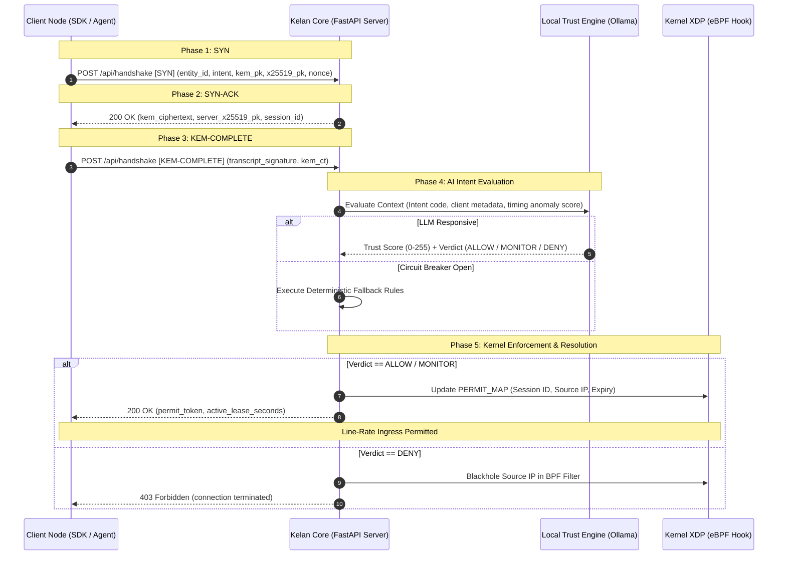

# Kelan Security — Adaptive Intent Transport Protocol (AITP)

<div align="center">


### Enterprise-Grade Zero-Trust Network Defense Powered by Local AI & Kernel eBPF/XDP

[](LICENSE)
[](https://github.com/Kelan-Security/kelan-core/actions/workflows/ci.yml)
[](https://www.rust-lang.org)
[](https://python.org)
[](https://ebpf.io)
[](https://csrc.nist.gov/pubs/fips/203/final)
[](https://ollama.com)

[**Website**](https://kelansecurity.vercel.app/) • [**Architecture**](#architecture--packet-flow) • [**Quick Start**](#quick-start) • [**Core Capabilities**](#product-pillars--core-capabilities) • [**API Reference**](#api-reference) • [**Documentation**](docs/kelan_documentation.md)

</div>

---

## Executive Summary

Modern perimeter defense is broken. Traditional firewalls and cloud-managed microsegmentation solutions rely on static 5-tuple policies (`IP`, `port`, `protocol`), introduce latency through remote telemetry calls, and remain vulnerable to **Harvest Now, Decrypt Later (HNDL)** quantum adversaries.

**Kelan AITP (Adaptive Intent Transport Protocol)** is a sovereign, self-contained **Zero-Trust Network Architecture (ZTNA)** and high-performance packet firewall. It replaces passive rule checks with proactive, cryptographically authenticated **Intent Validation**:

1. **Kernel-Level XDP Enforcement**: Rust-based eBPF filters drop unauthorized traffic at wire-speed before packets hit the host TCP/IP stack.
2. **Air-Gapped Local AI Intelligence**: Evaluates connection context, packet cadence, and anomalous behavior via an on-premise LLM (`gemma3`/`gemma4` via Ollama) with sub-second inference.
3. **Post-Quantum Cryptography (PQC)**: NIST FIPS 203 (`ML-KEM-768`) and FIPS 204 (`ML-DSA-65`) combined with classical `Ed25519` + `X25519` hybrid key exchanges.
4. **Zero Cloud Dependencies**: 100% on-premise execution. No SaaS telemetry, no external keys, and full air-gap compliance.

---

## Architecture & Packet Flow

Kelan bridges kernel-space packet filtering with userspace intelligence through asynchronous BPF maps:

```
┌────────────────────────────────────────────────────────────────────────────────────────┐
│                                   KELAN DEFENSE STACK                                  │
│                                                                                        │
│  [ Ingress Traffic ]                                                                   │
│          │                                                                             │
│          ▼                                                                             │
│  ┌───────────────┐         [ BPF Maps ]                                                │
│  │   eBPF / XDP  │ ◄─────── PERMIT_MAP ──────┐                                         │
│  │   Kernel Hook │ ◄─────── SYN_RATE_MAP     │                                         │
│  └───────┬───────┘                           │                                         │
│          │ [PASS] (Verified Session)         │ [Allow / Drop Updates]                  │
│          │                                   │                                         │
│          ▼                                   │                                         │
│  ┌───────────────────────────────────────────────────────────┐                         │
│  │                  KELAN INTELLIGENCE CORE                  │                         │
│  │                                                           │                         │
│  │   ┌─────────────────────┐       ┌──────────────────────┐  │                         │
│  │   │  AITP 5-Phase       │       │  Hybrid Trust Engine │  │                         │
│  │   │  Handshake FSM      ├──────►│  • Circuit Breaker   │  │                         │
│  │   │  (ML-KEM-768+Ed25519│       │  • Fallback Rules    │  │                         │
│  │   └──────────┬──────────┘       └──────────┬───────────┘  │                         │
│  │              │                             │              │                         │
│  │              ▼                             ▼              │                         │
│  │   ┌─────────────────────┐       ┌──────────────────────┐  │                         │
│  │   │  Sentinel Threat    │       │  Local LLM Ingestion │  │                         │
│  │   │  Anomaly Engine     │       │  (Ollama / Gemma)    │  │                         │
│  │   └─────────────────────┘       └──────────────────────┘  │                         │
│  └───────────────────────────────────────────────────────────┘                         │
│                                              │                                         │
│                                              ▼                                         │
│                                     [ Real-Time Ops Hub ]                              │
│                                     WebSocket + Grafana 3000                           │
└────────────────────────────────────────────────────────────────────────────────────────┘
```

### The 5-Phase AITP Handshake Protocol



---

## Product Pillars & Core Capabilities

| Pillar | Capability | Description |
| :--- | :--- | :--- |
| **⚡ High-Throughput Kernel XDP** | Line-Rate Mitigation | Rejects malicious packets at the network driver hook, minimizing CPU degradation during volumetric SYN/UDP floods. |
| **🧠 Local AI Trust Engine** | Dynamic Classification | Scores connection intent with zero cloud reliance using locally hosted Gemma models (`gemma3`, `gemma4`). |
| **🛡️ Resilience & Safety** | 3-State Circuit Breaker | Features automated `CLOSED` $\to$ `OPEN` $\to$ `HALF_OPEN` fail-safes. Degrades to deterministic security heuristics if local AI engine is busy. |
| **🔒 Post-Quantum Defense** | Quantum-Proof Transit | Implements ML-KEM-768 for quantum-safe key exchange and Ed25519 identity verification against future decryption threats. |
| **👁️ Threat Sentinel** | Anomaly Reconnaissance | Continuously flags port sweeps, credential stuffing, rate-limit violations, and rapid Sybil enrollment bursts. |
| **📊 Real-Time Operations Hub** | Unified Telemetry | Live event feeds via WebSockets, Prometheus metrics export, and pre-configured Grafana monitoring dashboards. |

---

## Quick Start

### 1. Prerequisites

| Component | Minimum Version | Installation Command |
| :--- | :--- | :--- |
| **Linux / macOS** | Linux 5.15+ (for eBPF) or macOS 13+ | System native |
| **Python** | 3.10 – 3.12 | `brew install python@3.12` / `apt install python3-venv` |
| **Rust Toolchain** | 1.77+ | `curl --proto '=https' --tlsv1.2 -sSf https://sh.rustup.rs \| sh` |
| **Ollama** | Latest | `curl -fsSL https://ollama.com/install.sh \| sh` |

### 2. Installation (Automated)

Clone the repository and run the installation script:

```bash
git clone https://github.com/Kelan-Security/kelan-core.git
cd kelan-core

# Set up Python virtual environment, dependencies, and build Rust components
bash install.sh
```

### 3. Model Configuration & Environment Setup

Kelan requires an operational Ollama instance hosting a Gemma model for real-time inference:

```bash
# Pull model locally
ollama pull gemma3:latest

# Configure environment
cp .env.example .env
```

Key environment properties in `.env`:

```ini
AITP_HTTP_PORT=3000
AITP_HOST=0.0.0.0
DATABASE_URL=sqlite+aiosqlite:///data/aitp.db

# Local Ollama endpoint
OLLAMA_ENDPOINT=http://localhost:11434
OLLAMA_MODEL=gemma3:latest
OLLAMA_TIMEOUT=8

# Security & Crypto Policies
REQUIRE_PQ=true
SYN_RATE_LIMIT=50
CB_FAILURE_THRESHOLD=3
CB_RECOVERY_TIMEOUT=30
```

### 4. Launching the Stack

Kelan provides a unified launch coordinator:

```bash
# Development Mode (interactive console & local watchers)
bash launch.sh --dev

# Production Mode (daemonized with full container stack)
bash launch.sh --prod

# Graceful Shutdown
bash launch.sh --stop
```

Verify the health check once started:
```bash
curl -s http://localhost:3000/health | jq .
```
```json
{
  "status": "ok",
  "version": "4.0.0-python",
  "ollama": "connected",
  "circuit_breaker": "closed"
}
```

---

## Production Deployment Options

### Option A: Systemd Service (Bare-Metal Linux)

Deploy Kelan as a persistent system service with root/CAP_NET_ADMIN privileges for eBPF attachment:

```ini
# /etc/systemd/system/kelan.service
[Unit]
Description=Kelan Security Core Intelligence Server
After=network.target ollama.service

[Service]
Type=simple
User=root
WorkingDirectory=/opt/kelan
ExecStart=/opt/kelan/.venv/bin/python -m uvicorn kelan.api.server:app --host 0.0.0.0 --port 3000
EnvironmentFile=/opt/kelan/.env
Restart=always
RestartSec=5
LimitNOFILE=65536

[Install]
WantedBy=multi-user.target
```

```bash
sudo systemctl daemon-reload
sudo systemctl enable --now kelan
```

### Option B: Docker Compose (Monitoring Included)

Kelan ships with pre-configured production Docker Compose setups:

```bash
# Run the core intelligence engine and monitoring services
docker-compose -f yml/docker-compose.prod.yml up -d
```

- **Intelligence Server**: `http://localhost:3000`
- **Prometheus Scraper**: `http://localhost:9090`
- **Grafana Live Dashboard**: `http://localhost:3001` (Credentials: `admin` / `aitp_admin`)

---

## API Reference

The Kelan Intelligence Server exposes comprehensive REST and WebSocket APIs. Interactive Swagger documentation is available at `http://localhost:3000/docs`.

### 1. Initiate AITP Handshake (Phase 1: SYN)

```http
POST /api/handshake
Content-Type: application/json

{
  "phase": "SYN",
  "entity_id": "8f4b23c9a1e05d...",
  "intent": "DB_QUERY_READ_ONLY",
  "nonce_c": "94a0d912f8...",
  "kem_pk": "e4b209a...",
  "x25519_pk": "18f0a42..."
}
```

**Response (200 OK):**
```json
{
  "session_id": "73c68e98-21ad-4679-b1d5-86561e1b4ec3",
  "phase": "SYN_ACK",
  "kem_ciphertext": "99b0c72...",
  "server_x25519_pk": "66df01a...",
  "status": "pending_verification"
}
```

### 2. Real-Time Trust Evaluation

Direct inference query to the Hybrid Trust Engine:

```http
POST /api/trust/evaluate
Content-Type: application/json

{
  "session_id": "73c68e98-21ad-4679-b1d5-86561e1b4ec3",
  "entity_id": "service.billing.production",
  "intent": "RESTRICTED_ACCESS",
  "source_ip": "10.0.24.15",
  "metadata": {
    "payload_hash": "e3b0c44298fc1c149afbf4c8996fb92427ae41e4649b934ca495991b7852b855",
    "ports_scanned": 0
  }
}
```

**Response (200 OK):**
```json
{
  "verdict": "ALLOW",
  "trust_score": 0.94,
  "confidence": 0.98,
  "reason": "Authorized entity signature, expected access window",
  "engine": "ollama:gemma3",
  "action": "PERMIT"
}
```

### 3. Threat Intelligence & Sentinel Telemetry

```http
GET /api/anomalies?limit=10
```

```json
[
  {
    "source": "192.168.1.105",
    "kind": "port_scan",
    "severity": 0.85,
    "details": {
      "ports_probed": 1000,
      "pattern": "reconnaissance"
    },
    "ts": 1774163942.12
  }
]
```

### 4. Real-Time WebSocket Streaming

Connect to `ws://localhost:3000/ws/logs` or `ws://localhost:3000/ws/agent` to stream real-time packet verdicts, circuit breaker events, and sentinel alerts.

---

## Adversarial Verification & Red Teaming

Kelan includes an integrated security testing framework to simulate hostile network behavior:

```bash
# Execute automated multi-vector attack suite
bash scripts/simulate_attacks.sh

# Run throttled attack simulation (for dashboard visualization)
bash scripts/simulate_attacks_throttled.sh
```

**Attack Vectors Tested:**
1. **Port Sweep & Reconnaissance**: Rapid TCP probe sweeps across multi-port ranges.
2. **Volumetric SYN Floods**: High-cadence unauthenticated packet bursts targeting the data plane.
3. **Sybil Registration Swarms**: Distributed entity enrollment attempts within tight temporal windows.
4. **Credential Stuffing & Auth Brute-Force**: Repeated cryptographic signature mismatches and invalid handshakes.

---

## Repository Structure

```
kelan-core/
├── aitp.toml                  # Daemon node configuration & cryptographic parameters
├── install.sh                 # Environment setup and dependency installation script
├── launch.sh                  # Operational service orchestrator (--dev, --prod, --stop)
├── Makefile                   # Build targets, test harnesses, and code linters
│
├── kelan/                     # Python Core Runtime (Intelligence Server)
│   ├── ai/                    # Ollama client, prompt templates, HybridTrustEngine
│   ├── api/                   # FastAPI endpoints, WebSockets, security middleware
│   ├── crypto/                # ML-KEM-768, Ed25519 identity, X25519 key derivation
│   ├── db/                    # SQLAlchemy async models & persistence layer
│   ├── enforcement/           # Userspace-to-eBPF subprocess IPC bridge
│   ├── protocol/              # AITP 5-phase handshake state machine
│   ├── sentinel/              # Real-time heuristics & threat anomaly detector
│   └── trust/                 # Deterministic fallback evaluation logic
│
├── kelan-ebpf/                # Rust eBPF/XDP High-Performance Layer
│   ├── kelan-ebpf-program/    # In-kernel XDP packet dropping logic
│   └── kelan-ebpf-loader/     # Userspace loader, BPF map driver & OS fallbacks
│
├── aitp-sdk/                  # Client library (Rust) for zero-trust application integration
├── proto/                     # Protocol Buffers (Control Plane gRPC interface)
├── static/                    # Built-in live telemetry and admin dashboards
├── scripts/                   # Red team simulation, health checks, and cert generators
├── docs/                      # Architectural specifications and operator manuals
└── yml/                       # Production Docker Compose, Prometheus, and Grafana specs
```

---

## Enterprise Security & Integrity

- **Strict Cryptographic Zero-Trust**: Connections require cryptographic intent binding and post-quantum keys; untrusted connections are discarded before TCP stack processing.
- **Air-Gapped Sovereign AI**: No prompt data, tokens, or traffic signatures ever leave your physical or virtual private boundary.
- **Static Analysis & Auditing**: Weekly automated dependency audits (`cargo audit`, `pip-audit`) and secrets scanning (`TruffleHog`).

### Responsible Disclosure

If you discover a security vulnerability within Kelan Core, please notify the security team directly at **`security@kelan.io`** rather than opening a public issue. We adhere to coordinated vulnerability disclosure within 48 hours.

---

## Contributing & Community

We welcome contributions from systems engineers, cryptographers, and security researchers.

1. Review the [Contributing Guidelines](docs/CONTRIBUTING.md) and [Code of Conduct](docs/CODE_OF_CONDUCT.md).
2. Fork the repository and create a feature branch (`git checkout -b feat/quantum-acceleration`).
3. Ensure all tests pass: `pytest` and `cargo test`.
4. Open a Pull Request detailing implementation logic and benchmarks.

---

## Academic Citation

If you use or reference Kelan AITP in academic research or technical publications, please cite:

```bibtex
@inproceedings{kelan_aitp_2026,
  author    = {Tanush Jain},
  title     = {AITP: Adaptive Intent Transport Protocol for Zero-Trust Network Security with Local AI Enforcement},
  booktitle = {Proceedings of the IEEE Conference on Communications and Network Security (CNS)},
  year      = {2026}
}
```

---

<div align="center">

**Built with precision by [Kelan Security](https://github.com/Kelan-Security)**  
*Lead Architect & Author: [Tanush Jain](https://github.com/Tanush-Jain)*

[](https://github.com/Kelan-Security/kelan-core)

</div>
